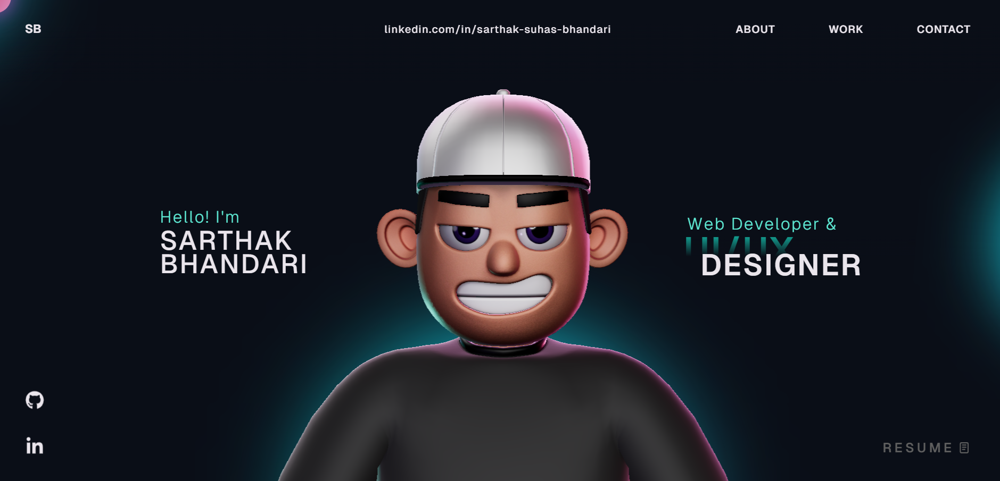

# Sarthak Bhandari — UI/UX Designer Portfolio

Personal 3D portfolio website built with React, TypeScript, Three.js, and GSAP. Features a 3D animated character scene, scroll-driven animations, interactive skill sections, and project showcases.

Live site: [Sarthak-Bhandari-Portfolio](https://sarthak-bhandari-portfolio.vercel.app/)



## About

UI/UX designer focused on creating clean, intuitive, and user-centered digital experiences. Experienced in user flows, wireframing, information architecture, prototyping, visual hierarchy, and responsive interface design using Figma and modern frontend technologies. Combines design thinking with development knowledge to create practical, implementation-ready interfaces. Graphic Design Lead for E-Cell and CSBSSA.

- LinkedIn: [linkedin.com/in/sarthak-bhandari-17ba2528b](https://www.linkedin.com/in/sarthak-bhandari-17ba2528b)
- GitHub: [github.com/sarthak0105](https://github.com/sarthak0105)
- Email: sarthakbhandarisb0105@gmail.com

## Projects Featured

- **Note Pilot** — Clinical documentation workflow & interface (Next.js, React, TypeScript, Gemini API) — [note-pilotai.vercel.app](https://note-pilotai.vercel.app)
- **VOX-AI** — AI-powered debate analysis dashboard (Next.js, Gemini API) — [vox-ai-nu.vercel.app](https://vox-ai-nu.vercel.app/)
- **DeployZen** — 5-step ML deployment workflow & platform (Next.js, ONNX Runtime) — [deploy-zen-five.vercel.app](https://deploy-zen-five.vercel.app)

## Tech Stack

### Core
- React 18 + TypeScript + Vite

### 3D & Animation
- Three.js, `@react-three/fiber`, `@react-three/drei`, `@react-three/rapier`
- GSAP + ScrollTrigger + ScrollSmoother + SplitText

### Supporting
- `react-icons`, `react-fast-marquee`, `@vercel/analytics`

## Skills

- **UI/UX**: Figma, Framer, Lovable, Adobe XD, Wireframing, Prototyping, User Flows, Information Architecture
- **Graphic Design**: Figma, Adobe Illustrator, Adobe Photoshop, Adobe After Effects, Canva
- **Design**: Visual Hierarchy, Responsive Design, Design Systems, Interaction Design, Usability, User-Centered Design
- **Programming**: HTML5, CSS3, JavaScript, Python
- **Frontend**: React.js, Next.js, Tailwind CSS
- **Backend**: Node.js, REST APIs

## Getting Started

```bash
# Clone the repo
git clone https://github.com/sarthak0105/Sarthak-Bhandari-Portfolio.git
cd Sarthak-Bhandari-Portfolio

# Install dependencies
npm install

# Start dev server
npm run dev
```

Open `http://localhost:5173` in your browser.

## Available Scripts

- `npm run dev` — Start development server
- `npm run build` — Build for production
- `npm run preview` — Preview production build
- `npm run lint` — Run ESLint

## Project Structure

```text
.
├── public/                    # Static assets (images, models, resume)
├── src/
│   ├── components/
│   │   ├── Character/         # 3D scene + character logic
│   │   ├── styles/            # Component CSS files
│   │   ├── About.tsx
│   │   ├── Skills.tsx
│   │   ├── Contact.tsx
│   │   ├── Landing.tsx
│   │   ├── MainContainer.tsx
│   │   ├── Navbar.tsx
│   │   ├── TechStack.tsx
│   │   ├── WhatIDo.tsx
│   │   └── Work.tsx
│   ├── context/               # Loading state provider
│   ├── data/                  # Static data definitions
│   ├── App.tsx
│   └── main.tsx
├── package.json
└── vite.config.ts
```

## Deployment

```bash
npm run build
npm run preview
```

Deploy the `dist/` folder to Vercel, Netlify, or Cloudflare Pages.

## License

This project is open source and available under the [MIT License](LICENSE).
